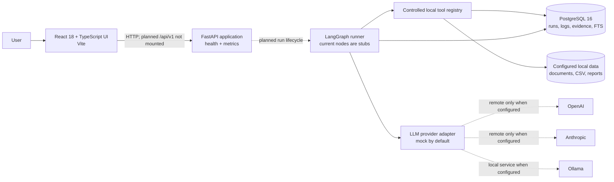
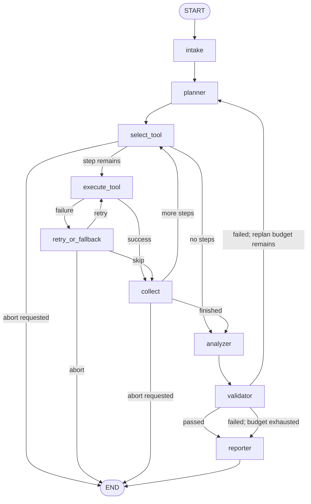
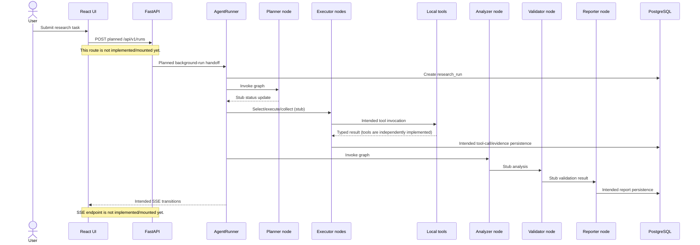
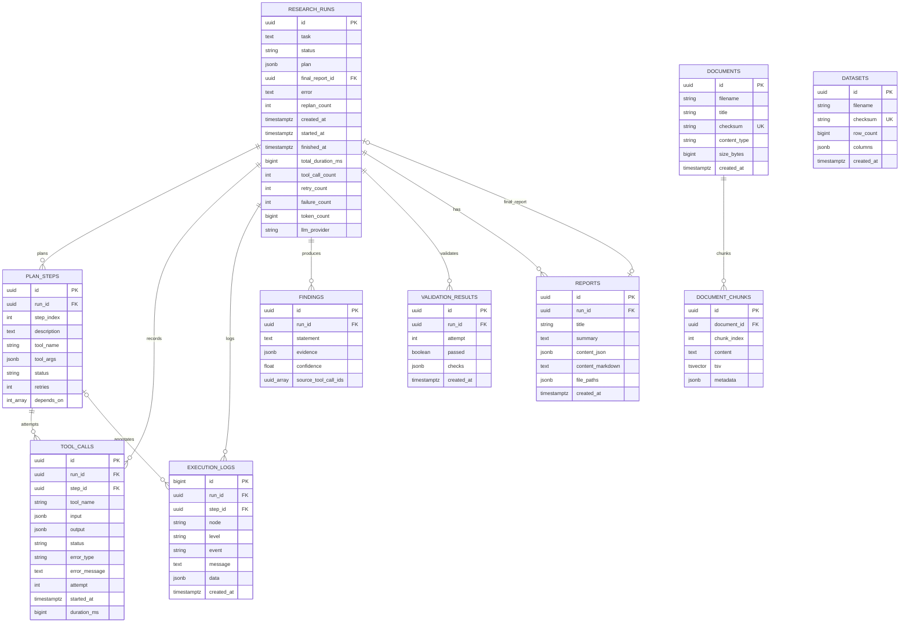
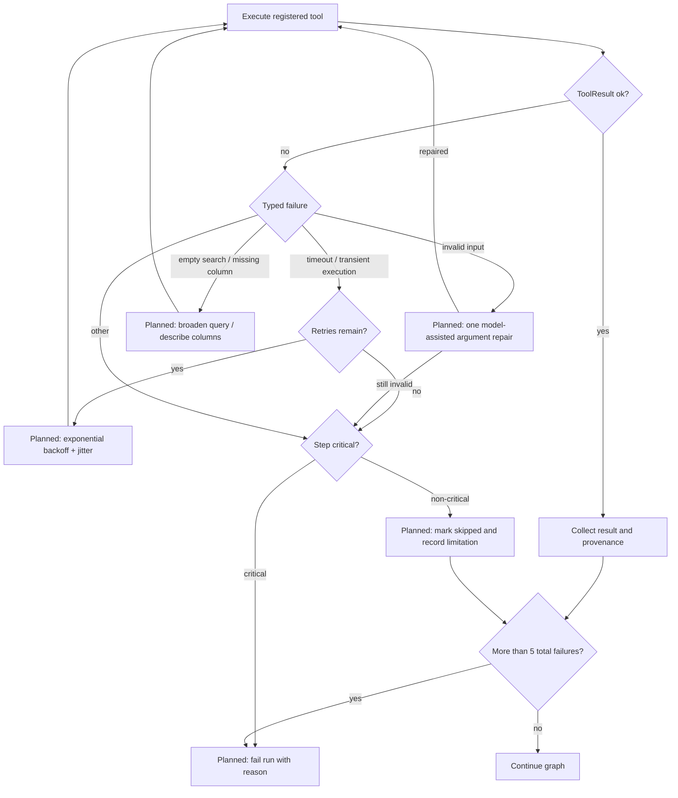

# Architecture

ResearchPilot is designed as a local, controlled research system. The diagrams distinguish the current scaffold from behavior that is specified but not implemented yet. In particular, the graph topology exists, but its nodes are stubs and the planned `/api/v1` lifecycle API is not mounted.

## System context and containers



The system diagram source is [`diagrams/system.mmd`](diagrams/system.mmd); `make diagrams` exports [`images/architecture.png`](images/architecture.png) at 2x scale. It requires Node/npm and downloads the pinned Mermaid CLI on first run. Windows without GNU Make can run the target command directly from the repository root:

```powershell
npx --yes @mermaid-js/mermaid-cli@11.4.2 -i docs/diagrams/system.mmd -o docs/images/architecture.png -b transparent -s 2
```

## Agent graph

The topology below matches [`agent_graph.mmd`](agent_graph.mmd). Intake, planning, tool execution, analysis, validation, persistence of tool attempts, and report generation are currently scaffold/stub behavior, not a functioning research workflow.



The route functions are deterministic state routers. Current code does not yet implement the planned dynamic plan creation, dependency resolution, retries/fallbacks, or validation/replanning behavior in the nodes.

## Run sequence



## Persistence ER diagram

The entity names and primary relationships reflect SQLAlchemy models and migrations. A solid relationship indicates a foreign key in the current model. The report/run relationship includes a final-report pointer and a report-to-run foreign key.



Document chunks have a generated PostgreSQL `tsvector` and GIN index. Dataset files themselves remain under the configured data directory; the `datasets` table records checksum and schema metadata.

## Retry and failure decision flow



The flowchart is the intended reliability policy from the product specification. The current graph has retry/skip/abort routing edges, but the retry/fallback node is a stub and does not implement this policy.

## Operational boundaries

- No external web-search tool exists; tools are explicitly registered local operations.
- Document search and CSV access require PostgreSQL and registered/ingested records.
- `GET /health` and `GET /metrics` are mounted. The API lifecycle and SSE routes shown in design diagrams are planned only.
- PostgreSQL integration tests require a disposable isolated database. The fixture may drop/recreate tables.
